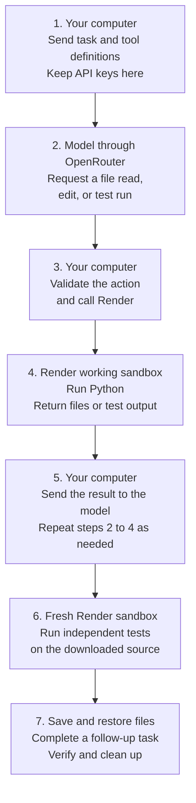

# Run OpenRouter Agents in Render Sandboxes

To run AI-generated code in an isolated environment with OpenRouter, give the model tools that your application executes in a Render Sandbox. <a href="https://openrouter.ai/" target="_blank" rel="noopener noreferrer">OpenRouter</a> connects your application to AI models. <a href="https://render.com/docs/sandboxes" target="_blank" rel="noopener noreferrer">Render Sandboxes</a> provide temporary Linux environments where the generated code runs separately from your application. Your application keeps the credentials, checks each requested action, and sends the results back to the model.

This guide runs a complete example with a TypeScript or Python program, called a client, on your computer. Both clients execute **Python code in Render**. The model repairs an invoice calculation that returns **125 cents instead of 375**, then adds shipping after the project files are restored into a new sandbox. You get the corrected source, independent test results, and confirmed cleanup.

> [!NOTE]
> **Render Sandboxes is in early access.** APIs, defaults, and limits might change. [Request Sandbox access](https://render.com/sandboxes) before running this guide if your workspace is not enabled. Discuss production workloads with your Render contact.

## How OpenRouter sandbox execution works

The model can request an action such as reading a file or running tests. This is called **tool calling**. In this integration, the local client receives those requests and uses Render's software development kit (SDK) to run the allowed actions in the sandbox. The SDK is the library that lets your code create and manage Render resources.



OpenRouter requests originate from your computer. The sandbox receives neither API key and has outbound network access disabled. File contents and test output travel back through your client to OpenRouter and the selected model provider, so use sample data you intend to send to that provider.

Your application can also run this client on a server. The model request, tool validation, and sandbox execution still have the same roles.

### Does OpenRouter provide its own sandboxes?

Yes. OpenRouter offers hosted code execution through server tools, including <a href="https://openrouter.ai/docs/guides/features/server-tools/bash" target="_blank" rel="noopener noreferrer">Bash on its Messages API</a> and <a href="https://openrouter.ai/docs/guides/features/server-tools/shell" target="_blank" rel="noopener noreferrer">Shell on its Responses API</a>. Those tools use OpenRouter-managed containers when server-side execution is enabled.

Choose the pattern in this guide when your application needs to manage execution in its own Render workspace, including sandbox creation, network policy, file snapshots, and termination. It uses OpenRouter's <a href="https://openrouter.ai/docs/guides/features/tool-calling" target="_blank" rel="noopener noreferrer">client tools</a> through the Chat Completions API. It does not require a hosted OpenRouter container or Render Workflows.

## Prerequisites

- A <a href="https://render.com/docs/sandboxes#1-confirm-access" target="_blank" rel="noopener noreferrer">Render workspace with Sandboxes enabled</a>. In the Dashboard's **+ New** menu, check for **Sandbox Group**. If it is missing, request access before running the example.
- <a href="https://openrouter.ai/settings/keys" target="_blank" rel="noopener noreferrer">OpenRouter access and model credits</a>. The tested model is `anthropic/claude-haiku-5.5`.
- <a href="https://git-scm.com/install/" target="_blank" rel="noopener noreferrer">Git</a>, plus <a href="https://nodejs.org/en/download" target="_blank" rel="noopener noreferrer">Node.js 22 or later</a> for TypeScript, or <a href="https://www.python.org/downloads/" target="_blank" rel="noopener noreferrer">Python 3.11 or later</a> for Python.
- A terminal using a macOS or Linux shell for the commands below.

Prepare these three configuration values. Your client requests work through each service's application programming interface (API). API keys authorize those requests; the workspace ID selects where Render creates resources.

| Variable | Where to get it | Required access and purpose | Where it stays |
| --- | --- | --- | --- |
| `RENDER_API_KEY` | <a href="https://render.com/docs/api#1-create-an-api-key" target="_blank" rel="noopener noreferrer">Create a Render API key</a> | A Render user with permission to create, inspect, terminate, and snapshot sandboxes in the selected workspace | Your computer |
| `RENDER_WORKSPACE_ID` | The `tea-...` value at the top of your workspace's **Settings** page in the <a href="https://dashboard.render.com/" target="_blank" rel="noopener noreferrer">Render Dashboard</a> | Selects that workspace; this ID is not a secret | Your computer |
| `OPENROUTER_API_KEY` | <a href="https://openrouter.ai/settings/keys" target="_blank" rel="noopener noreferrer">Create an OpenRouter API key</a> | Permission and credits for the selected model | Your computer |

Each complete run creates four temporary sandboxes and one filesystem snapshot, and makes multiple model requests. It requests Render's `starter` Sandbox plan. Running both client languages repeats those operations. Review your workspace's Sandbox terms and the selected model's pricing before running it.

## 1. Clone and configure the example

In your terminal, download the <a href="https://github.com/ojusave/openrouter-sandboxes" target="_blank" rel="noopener noreferrer">OpenRouter Sandbox example</a> and enter its directory:

```shell
git clone https://github.com/ojusave/openrouter-sandboxes.git
cd openrouter-sandboxes
```

Create a configuration file that only your user can read or write:

```shell
cp .env.example .env
chmod 600 .env
```

Open `.env` in your editor and fill in `RENDER_API_KEY`, `RENDER_WORKSPACE_ID`, and `OPENROUTER_API_KEY`. Leave `OPENROUTER_MODEL` as supplied to use the tested model. Git ignores this file so the example's keys stay out of commits.

Load the file you just edited into the current terminal:

```shell
set -a
. ./.env
set +a
```

These commands print nothing on success. `set -a` makes the file's settings available to programs launched from this terminal; `set +a` turns that setting back off. A new terminal needs the configuration loaded again.

## 2. Run the code-repair agent

Choose one language. Both paths start from the `openrouter-sandboxes` directory and perform the same complete task.

### TypeScript

Install the exact package versions recorded in the example, then run the local client:

```shell
cd typescript
npm ci
npm run demo
```

The implementation is in <a href="https://github.com/ojusave/openrouter-sandboxes/blob/main/typescript/main.ts" target="_blank" rel="noopener noreferrer">`typescript/main.ts`</a>. It uses Render's TypeScript SDK and Node's built-in `fetch` function for OpenRouter requests.

### Python

Create a separate directory for this example's Python packages, install them, then run the local client:

```shell
cd python
python3 -m venv .venv
.venv/bin/python -m pip install -r requirements.txt
.venv/bin/python main.py
```

The `.venv` directory is a **virtual environment**, which keeps these packages separate from your other Python projects. The implementation is in <a href="https://github.com/ojusave/openrouter-sandboxes/blob/main/python/main.py" target="_blank" rel="noopener noreferrer">`python/main.py`</a>. It uses Render's Python SDK and HTTPX, a library for making web requests, to call OpenRouter.

The client uploads an invoice function and its tests. The broken function adds unit prices without multiplying by quantity: three items at 125 cents return 125 instead of 375. The model reads the files, changes the function, and runs the tests through these tools:

| Tool | What the client allows |
| --- | --- |
| `read_file` | Read `totals.py`, `test_totals.py`, or `test_followup.py` |
| `write_file` | Replace only `totals.py`, with at most 16,384 bytes of text |
| `run_tests` | Run the fixed visible tests and return limited output |

The <a href="https://github.com/ojusave/openrouter-sandboxes/blob/main/shared/contract.json" target="_blank" rel="noopener noreferrer">tool definitions and task instructions</a> are shared by both clients. Each client validates the tool name, file path, and arguments before executing the request. A <a href="https://github.com/ojusave/openrouter-sandboxes/blob/main/shared/remote.py" target="_blank" rel="noopener noreferrer">shared helper</a> runs inside Render and stops tests after 12 seconds or 16,384 bytes of output.

These are restrictions on the exposed tools. Generated Python still runs inside the sandbox, so the client checks the result independently in the next step.

## 3. Check the repair and restored files

The client performs verification and restoration automatically. A successful TypeScript run includes these checkpoints, abbreviated from an actual run:

```text
initial_tests_fail: true
repair_passed_independent_tests: true
restored_files_match: true
followup_passed_independent_tests: true
cleanup_verified: true
```

Python uses `True` on its final cleanup line. `initial_tests_fail: true` confirms that the starting program contains the expected bug; it is a successful check of the starting condition.

The client can be quiet while Render creates a sandbox, OpenRouter generates a response, or Render captures a snapshot. A sandbox's `creating` state means the environment is starting. `running` means it can execute commands. Neither state alone means the model finished its task.

| Check | Evidence of success |
| --- | --- |
| Repair the invoice calculation | Seven tests pass in a fresh sandbox, using the original tests and additional cases the model was not shown |
| Preserve project files | A filesystem snapshot is captured, the original sandbox is terminated, and the source and a random marker match in a different sandbox |
| Add shipping after restoration | A new model task adds `shipping_cents=0`; twelve independent tests pass, including a 375-cent invoice plus 50 cents shipping returning 425 |
| Remove temporary resources | Render reports the run's sandboxes terminated and its snapshot absent |

The model's own success message is not the acceptance check. The client downloads the source and tests it in fresh environments using copies of the original tests kept on your computer. The model cannot replace those originals through its tools.

A **filesystem snapshot** saves files for restoration into a new sandbox. This example does not restore a running process or model conversation. The follow-up starts a new conversation that reads the restored project files.

The terminal prints an `Evidence:` path under `.runs/`. Open that directory in your editor to inspect `repaired.py`, the final `totals.py`, and `run.json`. The JSON file records test results, model usage, resource IDs, and cleanup status. The client downloads the source for inspection; you do not need to execute the generated file on your computer.

Both language paths completed real OpenRouter and Render runs on October 12, 2026. See the <a href="https://github.com/ojusave/openrouter-sandboxes/blob/main/VALIDATION.md" target="_blank" rel="noopener noreferrer">tested versions, sanitized evidence, and proof limits</a>. Both Render SDKs are pinned to 1.2.0. These tests establish this sample's behavior, not correctness for every generated program or OpenRouter model.

## 4. Confirm cleanup or recover an interrupted run

The client downloads the results before terminating the four sandboxes and deleting the snapshot. It attempts cleanup after success and handled failures, then checks Render's reported state. Your downloaded files remain in `.runs/`.

> [!WARNING]
> Terminating a sandbox discards its filesystem. Deleting the snapshot removes the saved restore point. Save any files you want to keep before removing either resource. A successful run downloads both versions of `totals.py` before cleanup.

If the process stops before `cleanup_verified: true`, find its `run.json` under `.runs/` and retry cleanup for that run. In the commands below, replace `YOUR-RUN` with the directory name from the printed `Evidence:` path. Run from your chosen `typescript` or `python` directory with the same configuration loaded.

### TypeScript

```shell
npm run demo -- cleanup --run-dir ../.runs/YOUR-RUN
```

### Python

```shell
.venv/bin/python main.py cleanup --run-dir ../.runs/YOUR-RUN
```

Cleanup only uses resource IDs recorded by that run. Confirm that `cleanup_verified` becomes `true` in `run.json`. Sandboxes also have a ten-minute lifetime, and the snapshot expires after one hour, but these limits do not replace confirming cleanup.

> [!WARNING]
> If `run.json` contains `pending_create` or `pending_snapshot`, a creation request had an unknown outcome. Inspect Render resources using the recorded time or snapshot name before creating another resource. Retrying creation immediately can produce duplicates.

When you no longer need the credentials in this terminal, remove them from its environment:

```shell
unset RENDER_API_KEY RENDER_WORKSPACE_ID OPENROUTER_API_KEY OPENROUTER_MODEL
```

The private `.env` file remains on your computer for future runs. Delete that file too if you no longer need the local configuration.

## Adapt the example to your application

Replace the sample invoice task and files with the work your agent needs to perform. Keep credentials in the application, validate tool requests before execution, and verify generated outputs independently. A prompt asking the model to respect a boundary does not enforce that boundary.

To try another model, set `OPENROUTER_MODEL` in `.env` to a model that supports <a href="https://openrouter.ai/docs/guides/features/tool-calling" target="_blank" rel="noopener noreferrer">tool calling</a>, reload the configuration, and rerun the independent checks. The example requests a provider that supports its supplied parameters; changing models can change behavior and cost.

This example uses Python's built-in libraries and denies outbound network access. A task that needs package downloads or external services needs an explicit dependency and network policy. Configure that through the <a href="https://render.com/docs/sandboxes" target="_blank" rel="noopener noreferrer">Sandbox lifecycle and network controls</a> for your workload. Keep the run's limits and cleanup path when adapting it.

## Troubleshooting

| Symptom | Next step |
| --- | --- |
| Missing configuration or authentication error | Check the three required values in `.env`, then reload that file in the terminal running the client. Check Sandbox access on the selected workspace and credits on the OpenRouter key. |
| Model returns no usable completion or reaches its tool limit | Inspect `run.json` for the recorded model, tool requests, and test outcome. Use the tested model first. Each task allows up to ten model responses and twenty-four tool calls. |
| Tests exceed runtime or output limits | Read the recorded test output and inspect the generated source. The helper stops the test process; resolve the failure before accepting the result. |
| Independent tests fail | Treat the repair as unsuccessful. Inspect the downloaded source and test results instead of relying on the model's completion message. |
| Cleanup is unconfirmed | Run the cleanup command above for the original run directory and reconcile any pending creation before rerunning the demo. |

For automated checks that require no API keys, see <a href="https://github.com/ojusave/openrouter-sandboxes#run-the-checks" target="_blank" rel="noopener noreferrer">the repository's test commands</a>.

## Related guides

- <a href="https://render.com/docs/sandboxes-sdk-typescript" target="_blank" rel="noopener noreferrer">Render Sandbox TypeScript SDK</a> and <a href="https://render.com/docs/sandboxes-sdk-python" target="_blank" rel="noopener noreferrer">Python SDK</a> for creating sandboxes, running commands, and managing snapshots.
- <a href="https://openrouter.ai/docs/guides/community/render" target="_blank" rel="noopener noreferrer">OpenRouter with Render Workflows</a> for a separate pattern that queues and retries background model calls.
