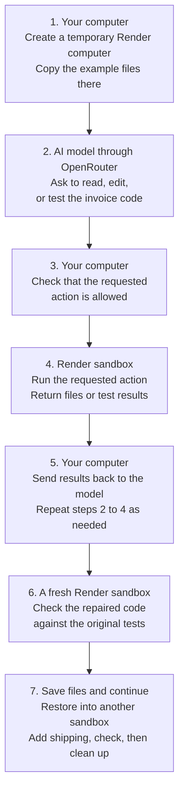

# Run OpenRouter Agents in Render Sandboxes

An AI model can write a code change, but running that code is how you find out whether it works. You need somewhere to run it, inspect the result, and try again without giving the generated code access to the computer that holds your other projects and account keys.

This guide connects <a href="https://openrouter.ai/" target="_blank" rel="noopener noreferrer">OpenRouter</a>, a service for sending requests to AI models, with <a href="https://render.com/docs/sandboxes" target="_blank" rel="noopener noreferrer">Render Sandboxes</a>, temporary places to run code. You will run an example that asks a model to fix an invoice total from **125 to 375 cents**, checks the answer, and then asks it to add shipping.

## What is a sandbox, and why use one here?

Imagine giving the model a separate computer containing the files it needs for one task. It can change those files and run the program there. When the task ends, you copy out the files you want and discard that computer. A temporary environment with this separation is called a **sandbox**.

In this example, the sandbox runs on Render. The generated Python code runs there, separately from the program on your computer. This separation is what **isolated code execution** means here. The code really runs: if the invoice calculation is wrong, a test reports the wrong answer. A sandbox provides a place to do that work; tests still need to check whether the work is correct.

You will see the process in your **terminal**, the application where you type commands and read their output. There is no website to open or application to deploy for this example. Starting the example on your computer creates the temporary environments on Render automatically.

## How OpenRouter sandbox execution works

Three parts work together:

| Part | Where it runs | Its job |
| --- | --- | --- |
| The example program | Your computer | Creates the sandboxes, sends requests, checks proposed actions, saves results, and cleans up |
| The AI model, reached through OpenRouter | The model provider's service | Reads the supplied code and asks for edits or test runs |
| The sandbox | Render | Holds the working files and runs the Python code and tests |

The program on your computer coordinates the other two parts. It is called a **client**. You can run either the TypeScript or Python version of this client; both run **Python code inside Render**.

For example, the model can ask, "Run the invoice tests." The client checks that this action is allowed, runs the tests in Render, and sends the output back to the model. An action the model can request is called a **tool**. Requesting it is **tool calling**. Repeating this process so the model can work toward a task is the agent behavior in this example.



The client keeps both account access keys on your computer. Neither key is sent into the sandbox, and code inside this sandbox cannot make outgoing network connections. The client does send sample file contents and test output to OpenRouter and the selected model provider so the model can decide what to do next.

The client could also run on a server. For this walkthrough, keep it on your computer so you can see the output and downloaded results directly.

> [!NOTE]
> **Render Sandboxes is in early access.** Interfaces, defaults, and limits might change. [Request Sandbox access](https://render.com/sandboxes) before running this guide if your workspace is not enabled. Discuss production workloads with your Render contact.

## Prerequisites

- A <a href="https://render.com/docs/sandboxes#1-confirm-access" target="_blank" rel="noopener noreferrer">Render workspace with Sandboxes enabled</a>. A workspace groups the resources you create on Render. In the Dashboard's **+ New** menu, check for **Sandbox Group**. If it is missing, request access before continuing.
- <a href="https://openrouter.ai/settings/keys" target="_blank" rel="noopener noreferrer">OpenRouter access and model credits</a>, which pay for model requests. The tested model is `anthropic/claude-haiku-5.5`.
- <a href="https://git-scm.com/install/" target="_blank" rel="noopener noreferrer">Git</a> to download the example, plus either <a href="https://nodejs.org/en/download" target="_blank" rel="noopener noreferrer">Node.js 22 or later</a> to run the TypeScript client, or <a href="https://www.python.org/downloads/" target="_blank" rel="noopener noreferrer">Python 3.11 or later</a> to run the Python client. You only need one client language.
- A macOS or Linux terminal for the commands below. On macOS, open the **Terminal** app; on Linux, open your distribution's terminal application.

The client needs permission to ask Render and OpenRouter to do work. A service accepts these requests through an **application programming interface (API)**. An **API key** is a secret value that authorizes your program to make those requests, similar to a password for software. Keep the two keys private.

| Setting | Where to get it | Why the client needs it |
| --- | --- | --- |
| `RENDER_API_KEY` | <a href="https://render.com/docs/api#1-create-an-api-key" target="_blank" rel="noopener noreferrer">Create a Render API key</a> | Permission to create, inspect, save copies of, and terminate sandboxes in your workspace |
| `RENDER_WORKSPACE_ID` | The `tea-...` value at the top of your workspace's **Settings** page in the <a href="https://dashboard.render.com/" target="_blank" rel="noopener noreferrer">Render Dashboard</a> | Selects where Render creates the sandboxes; this identifier is not a secret |
| `OPENROUTER_API_KEY` | <a href="https://openrouter.ai/settings/keys" target="_blank" rel="noopener noreferrer">Create an OpenRouter API key</a> | Permission and credits to ask the selected model for responses |

Each complete run uses Render's `starter` Sandbox plan and makes multiple model requests. It creates four temporary sandboxes: one for the first repair, one to check that repair, one for the shipping change, and one to check the final result. It also saves one temporary copy of the project files. Review your workspace's Sandbox terms and the selected model's pricing before running the example.

## 1. Clone and configure the example

In your terminal, go to the folder where you keep projects. Download your own copy of the <a href="https://github.com/ojusave/openrouter-sandboxes" target="_blank" rel="noopener noreferrer">OpenRouter Sandbox example</a>, a step called **cloning**, and enter its folder:

```shell
# Download the example into a new folder named openrouter-sandboxes.
git clone https://github.com/ojusave/openrouter-sandboxes.git
# Make that folder the location for the following commands.
cd openrouter-sandboxes
```

When this finishes, the folder contains `README.md`, `.env.example`, `typescript/`, and `python/`. Create a private settings file from the supplied template:

```shell
# Copy the settings template; add your own values to this new file next.
cp .env.example .env
# Allow only your computer's user account to read or change the file.
chmod 600 .env
```

Open the new `.env` file in a text editor and replace the placeholders for `RENDER_API_KEY`, `RENDER_WORKSPACE_ID`, and `OPENROUTER_API_KEY` with your values. Files whose names start with a dot can be hidden in file browsers; your editor's **Open File** dialog can open `.env` by name. Leave `OPENROUTER_MODEL` as supplied to use the tested model. Git is configured to exclude `.env` from saved code changes, so the keys are not included when you publish the example's code.

Make these settings available to programs started from this terminal:

```shell
# Share settings loaded next with programs started by this terminal.
set -a
# Read the .env file you just created and edited.
. ./.env
# Stop automatically sharing any additional settings you define later.
set +a
```

The settings are now **environment variables**, named values the client can read when it starts. These commands print nothing on success. Keep using this terminal; a new terminal needs the file loaded again from the `openrouter-sandboxes` folder.

## 2. Run the code-repair agent

The supplied Python program calculates an invoice total. Its bug is small enough to check by hand: **three items at 125 cents each should cost 375 cents**, but it returns 125 because it ignores the quantity. The supplied tests call the program with example inputs and compare the actual answers with the expected ones.

Choose one client below. Both paths start from the `openrouter-sandboxes` folder in the terminal where you loaded the settings. Either client runs the entire example, including checking the results and cleanup. If you have no language preference, use the one you installed in the prerequisites.

### TypeScript

Install the extra code libraries the client needs, called its **dependencies**, then start it:

```shell
# Enter the TypeScript client's folder.
cd typescript
# Install the exact library versions recorded with the example.
npm ci
# Start the client, which contacts OpenRouter and creates Render sandboxes.
npm run demo
```

### Python

Create a separate place for this client's extra code libraries and install them there. This folder is a Python **virtual environment**: it organizes packages on your computer. The Render sandbox is the separate place where generated code runs.

```shell
# Enter the Python client's folder.
cd python
# Create a local folder to hold this client's Python packages.
python3 -m venv .venv
# Install the library versions listed by the example into that folder.
.venv/bin/python -m pip install -r requirements.txt
# Start the client using that folder's Python program and libraries.
.venv/bin/python main.py
```

After installation, the final command starts the run. Watch this terminal; you do not need to issue commands inside Render manually. The client can be quiet while Render starts a sandbox or OpenRouter generates a response. Render's `creating` state means the environment is starting; `running` means it can execute commands. The checkpoints below show whether the task itself succeeded.

## 3. Check the repair and restored files

A successful TypeScript run prints these checkpoints, abbreviated from an actual run. Python uses `True` on its final cleanup line:

```text
initial_tests_fail: true
repair_passed_independent_tests: true
restored_files_match: true
followup_passed_independent_tests: true
cleanup_verified: true
```

**The first failure is expected.** `initial_tests_fail: true` confirms that the starting code has the bug the model is meant to fix. It does not mean setup failed.

| Checkpoint | What happened | What it tells you |
| --- | --- | --- |
| `initial_tests_fail` | The original invoice code failed its tests | The example reproduced the starting bug |
| `repair_passed_independent_tests` | The model's edited code passed seven tests in a fresh sandbox | The repair handles quantity, including the 375-cent example |
| `restored_files_match` | Saved files were restored into a different sandbox and matched the originals exactly | Work can continue after the first sandbox is removed |
| `followup_passed_independent_tests` | The model added shipping, and the final code passed twelve tests in a fresh sandbox | A 375-cent invoice plus 50 cents shipping returns 425 |
| `cleanup_verified` | Render reported the sandboxes terminated and the saved copy absent | The example's temporary resources have been removed |

Why save and restore files? A sandbox is temporary: terminating it discards its files. Render can save a copy of those files, called a **filesystem snapshot**, before termination. This example restores that copy into another sandbox to show how a later task can continue from earlier work. The shipping task starts a new model conversation that reads the restored files. The snapshot preserves files, not a running program or a model's conversation.

Why test in a fresh sandbox? A model can say it is finished even when its code is wrong. The client downloads the edited code and checks it using the original tests kept on your computer, plus additional cases the model was not shown. These **independent tests** provide evidence beyond the model's own success message. The model's tools cannot replace those original copies.

The terminal also prints an `Evidence:` path under `.runs/` in the downloaded project. Open that folder in your editor:

- `repaired.py` contains the first repair, before shipping was added.
- `totals.py` contains the final Python code, including shipping.
- `run.json` contains the run record: test results, model usage, Render resource identifiers, and cleanup status. JSON is a text format for storing named values that programs can read.

You can inspect these files after cleanup. You do not need to run the generated Python file on your computer; the checks already run inside Render.

Both client paths completed real OpenRouter and Render runs on October 12, 2026. See the <a href="https://github.com/ojusave/openrouter-sandboxes/blob/main/VALIDATION.md" target="_blank" rel="noopener noreferrer">tested versions, sanitized evidence, and proof limits</a>. Those tests establish this sample's behavior; other generated programs and models need their own checks.

## 4. Confirm cleanup or recover an interrupted run

The client downloads the results before terminating the four sandboxes and deleting the snapshot. Removing resources avoids leaving temporary computers and saved files behind after the task. It attempts cleanup after success and handled failures, then checks Render's reported state. Your downloaded files remain in `.runs/`.

> [!WARNING]
> Terminating a sandbox discards its filesystem. Deleting the snapshot removes the saved restore point. Save any files you want to keep before removing either resource. A successful run downloads both versions of `totals.py` before cleanup.

If the process stops before `cleanup_verified: true`, find its `run.json` under `.runs/` and retry cleanup for that run. In the commands below, replace `YOUR-RUN` with the directory name from the printed `Evidence:` path. Run from your chosen `typescript` or `python` directory with the same configuration loaded.

### TypeScript

```shell
# Remove the Render resources recorded for this run; replace YOUR-RUN first.
npm run demo -- cleanup --run-dir ../.runs/YOUR-RUN
```

### Python

```shell
# Remove the Render resources recorded for this run; replace YOUR-RUN first.
.venv/bin/python main.py cleanup --run-dir ../.runs/YOUR-RUN
```

Cleanup only uses resource IDs recorded by that run. Confirm that `cleanup_verified` becomes `true` in `run.json`. Sandboxes also have a ten-minute lifetime, and the snapshot expires after one hour, but these limits do not replace confirming cleanup.

> [!WARNING]
> If `run.json` contains `pending_create` or `pending_snapshot`, a creation request had an unknown outcome. Inspect Render resources using the recorded time or snapshot name before creating another resource. Retrying creation immediately can produce duplicates.

When you no longer need the credentials in this terminal, remove them from its environment:

```shell
# Remove these settings from this terminal; the .env file is unchanged.
unset RENDER_API_KEY RENDER_WORKSPACE_ID OPENROUTER_API_KEY OPENROUTER_MODEL
```

The private `.env` file remains on your computer for future runs. Delete that file too if you no longer need the local configuration.

## How the code connects the services

The clients use a library that provides commands for creating and managing Render sandboxes. This library is Render's **software development kit (SDK)**. Both client versions pin it to version 1.2.0 so installation uses the version tested with the example.

The <a href="https://github.com/ojusave/openrouter-sandboxes/blob/main/typescript/main.ts" target="_blank" rel="noopener noreferrer">TypeScript client</a> sends OpenRouter requests using Node's built-in `fetch` function. The <a href="https://github.com/ojusave/openrouter-sandboxes/blob/main/python/main.py" target="_blank" rel="noopener noreferrer">Python client</a> uses HTTPX, a library for sending web requests. Each client lets the model request these actions:

| Tool | What the client allows |
| --- | --- |
| `read_file` | Read `totals.py`, `test_totals.py`, or `test_followup.py` |
| `write_file` | Replace only `totals.py`, with at most 16,384 bytes of text |
| `run_tests` | Run the fixed visible tests and return limited output |

The <a href="https://github.com/ojusave/openrouter-sandboxes/blob/main/shared/contract.json" target="_blank" rel="noopener noreferrer">tool definitions and task instructions</a> are shared by both clients. Each client validates the tool name, file path, and arguments before executing the request. A <a href="https://github.com/ojusave/openrouter-sandboxes/blob/main/shared/remote.py" target="_blank" rel="noopener noreferrer">shared helper</a> runs inside Render and stops tests after 12 seconds or 16,384 bytes of output.

These are restrictions on the exposed tools. Generated Python still runs inside the sandbox, so the client also checks the result independently as described in step 3.

## Does OpenRouter provide its own sandboxes?

Yes. OpenRouter offers hosted code execution through server tools, including <a href="https://openrouter.ai/docs/guides/features/server-tools/bash" target="_blank" rel="noopener noreferrer">Bash on its Messages API</a> and <a href="https://openrouter.ai/docs/guides/features/server-tools/shell" target="_blank" rel="noopener noreferrer">Shell on its Responses API</a>. When you enable this execution option, OpenRouter runs the requested commands in temporary environments it manages.

Choose the pattern in this guide when your application needs to manage execution in its own Render workspace, including sandbox creation, network policy, file snapshots, and termination. It uses OpenRouter's <a href="https://openrouter.ai/docs/guides/features/tool-calling" target="_blank" rel="noopener noreferrer">client tools</a> through the Chat Completions API. It does not require a hosted OpenRouter container or Render Workflows.

## Adapt the example to your application

Replace the sample invoice task and files with the work your agent needs to perform. Keep credentials in the application, validate tool requests before execution, and verify generated outputs independently. A prompt asking the model to respect a boundary does not enforce that boundary.

To try another model, set `OPENROUTER_MODEL` in `.env` to a model that supports <a href="https://openrouter.ai/docs/guides/features/tool-calling" target="_blank" rel="noopener noreferrer">tool calling</a>, reload the configuration, and rerun the independent checks. The example requests a provider that supports its supplied parameters; changing models can change behavior and cost.

This example uses Python's built-in libraries and denies outbound network access. A task that needs package downloads or external services needs an explicit dependency and network policy. Configure that through the <a href="https://render.com/docs/sandboxes" target="_blank" rel="noopener noreferrer">Sandbox lifecycle and network controls</a> for your workload. Keep the run's limits and cleanup path when adapting it.

## Troubleshooting

| Symptom | Next step |
| --- | --- |
| Missing configuration or authentication error | Check the three required values in `.env`, then reload that file in the terminal running the client. Check Sandbox access on the selected workspace and credits on the OpenRouter key. |
| Model returns no usable completion or reaches its tool limit | Inspect `run.json` for the recorded model, tool requests, and test outcome. Use the tested model first. Each task allows up to ten model responses and twenty-four tool calls. |
| Tests exceed runtime or output limits | Read the recorded test output and inspect the generated source. The helper stops the test process; resolve the failure before accepting the result. |
| Independent tests fail | Treat the repair as unsuccessful. Inspect the downloaded source and test results instead of relying on the model's completion message. |
| Cleanup is unconfirmed | Run the cleanup command above for the original run directory and reconcile any pending creation before rerunning the demo. |

For automated checks that require no API keys, see <a href="https://github.com/ojusave/openrouter-sandboxes#run-the-checks" target="_blank" rel="noopener noreferrer">the repository's test commands</a>.

## Related guides

- <a href="https://render.com/docs/sandboxes-sdk-typescript" target="_blank" rel="noopener noreferrer">Render Sandbox TypeScript SDK</a> and <a href="https://render.com/docs/sandboxes-sdk-python" target="_blank" rel="noopener noreferrer">Python SDK</a> for creating sandboxes, running commands, and managing snapshots.
- <a href="https://openrouter.ai/docs/guides/community/render" target="_blank" rel="noopener noreferrer">OpenRouter with Render Workflows</a> for a separate pattern that queues and retries background model calls.
